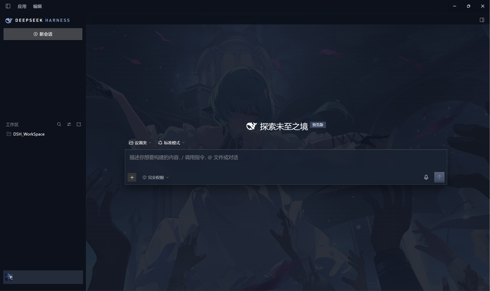
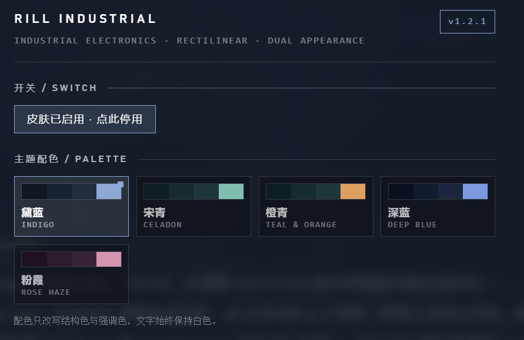

# Rill Industrial Skin

> 工业电子风格的 DeepSeek Harness 皮肤：全直角、深蓝工作区、白色字体、鲸鱼字标、双外观、可调壁纸与毛玻璃。
>
> An industrial-electronics skin for DeepSeek Harness: rectilinear chrome, deep blue workspace, white type, whale wordmark, dual appearance, adjustable wallpaper and frosted glass.



*设置页（`设置 → Rill工业风皮肤`）：开关、六套低饱和配色、四区不透明度、壁纸与毛玻璃参数。*



---

## 特性

| | |
|---|---|
| **直角** | 全界面 `border-radius: 0`，包括按钮、卡片、输入框、滚动条滑块与弹层 |
| **五区独立** | 左侧栏 / 右侧栏 / 底栏 / 会话标题条各有独立不透明度滑块；标题条恒 100%，中栏只由壁纸滑块控制 |
| **白色字体** | 字色恒为 `#fff` / `rgba(255,255,255,.72/.46)`，**任何调色板都不会改写文字颜色** |
| **鲸鱼字标** | 左上角 `sidebar.brand.mark`：鲸鱼剪影 + 直角工业风 `DEEPSEEK` 字母（宽字距、下压横线、`SEEK` 取强调色） |
| **双外观** | 跟随宿主 `data-ds-dark-theme` 标记，或跟随系统 `prefers-color-scheme`，也可手动锁定浅/深 |
| **壁纸** | 粘贴 URL 或选择任意本地图片（自动压到长边 1920 / JPEG 0.82，超限逐级降质后存本地），不透明度 0–100%、X＋Y 双向模糊 0–40px |
| **毛玻璃对话框** | `[data-composer-card]` 直角毛玻璃，透明度 8%–100%、模糊 0–40px 可调；弹层/菜单同套参数 |
| **凸起发送键** | 发送按钮为方形实体键：上高光 + 下暗边 + 落地投影，按下时真正压入（`inset` 阴影 + 位移 1px） |
| **六种低饱和配色** | 黛蓝 / 宋青 / 橙青 / 深蓝 / 粉霞 / 暮紫 |
| **扫描质感** | 仪器面板式细扫描线与竖向网格，可开关 |

## 配色

| 键 | 名称 | 深色强调色 | 浅色强调色 |
|---|---|---|---|
| `indigo` | 黛蓝 | `#8aa8d6` | `#b2cdee` |
| `celadon` | 宋青 | `#7cbeb0` | `#a2d6ca` |
| `tealorange` | 橙青 | `#e29e5c` | `#f0b476` |
| `deepblue` | 深蓝 | `#749ae2` | `#98b8f4` |
| `rose` | 粉霞 | `#d896ae` | `#ecb2c6` |
| `violet` | 暮紫 | `#9c8dd6` | `#c4b8ee` |

六种配色都是低饱和度工业色。`violet` 另带一个青绿操作色（深 `#6cc2bc` / 浅 `#8cd0ca`），只用在发送键、焦点环这类可点控件上；其余配色没有单独声明，`accent2` 回退到 `accent`，观感与原版一致。**浅色外观不是浅底**——皮肤在两种外观下都保持白字，所以浅色模式把工作区提到中深蓝（L≈45%）并抬亮面板，用这个办法维持白字对比度 ≥ 4.5:1。

## 变更

版本演进与每次修的是什么，见 [CHANGELOG.md](CHANGELOG.md)。

## 安装

本插件不在 npm 上，装法是「克隆到任意目录 → 登记成 profile 的 link 依赖」。**只建 junction 而不登记依赖，插件页会把它判成内置插件，没有卸载 / 更新按钮**——这一点踩过坑，写在 `docs/DETAIL.md`。

```bash
# 1. 克隆到任意位置（不必放进 node_modules）
git clone https://github.com/weilifox/dsh-Rill-industrial-skin.git ~/dsh-Rill-industrial-skin

# 2. 登记成 profile 依赖：link: 指向源码目录，改代码即时生效
cd ~/.dsh/profiles/desktop
node "<DSH 安装目录>/resources/app/runtime/primary-runtime/dependencies/pnpm/bin/pnpm.cjs" \
  add "link:/absolute/path/to/dsh-Rill-industrial-skin" --config.minimum-release-age=0
# Windows 例：link:D:/DSH-WorkSpace/设置类/rill-industrial-skin
```

3. 让 profile 加载它——`~/.dsh/profiles/desktop/package.json` 里加上名字：

```json
{ "dsh": { "profile": { "bundles": ["...", "dsh-rill-industrial-skin"] } } }
```

4. 重启 DeepSeek Harness（宿主启动时才重读 profile）。

做完这一步，`设置 → 插件` 里它就是正经的 profile 插件：可停用、可卸载、可看版本。仓库不在 npm 上，点「更新」会提示没有新版本，属正常。

### 卸载

- 只想恢复原生外观：设置页顶部「皮肤已启用 · 点此停用」，配置不丢；
- 正式卸载：插件页点卸载，或 `cd ~/.dsh/profiles/desktop && pnpm remove dsh-rill-industrial-skin`，再把 `dsh.profile.bundles` 里的名字去掉，重启。

宿主 `html[data-rill-industrial]` 不出现即代表插件未加载，样式完全不影响原生主题。

## 设置

`设置 → Rill工业风皮肤`（`settings.section` 槽，`layout: "fill"`）：

- **主题配色** — 六色板，含色条预览
- **外观** — 跟随系统 / 浅色 / 深色；四个区域各自的不透明度（左侧栏 / 右侧栏 / 底栏 / 会话标题条）；对话框透明度与模糊度；扫描质感开关
- **分区** — 中栏只听「壁纸不透明度 / 壁纸模糊度」，任何侧栏滑块都碰不到它（这是本插件最容易被误解、也最花功夫的一条）
- **壁纸** — URL 或本地文件、不透明度、模糊度、清除
- **恢复默认**

设置写在 `localStorage["rill-industrial-skin:settings:v1"]`，不上传任何数据。

## 结构

```
dsh-rill-industrial-skin/
├── package.json          # dsh.bundle.patch + dsh.client{platform:web}
├── cordis.patch.yml      # host 侧那条 loader 记录
├── lib/
│   ├── index.js          # host 半边（无副作用，仅声明身份）
│   └── client.js         # 全部实现：CSS 变量层 / 注入样式 / 字标 / 设置页
├── locale/{zh,en}.json
├── icon.svg
└── docs/
```

浏览器半边是单文件、零构建：一个 `<style data-plugin="dsh-rill-industrial-skin">`、一组写在 `html` 与 `html body` 上的 CSS 变量（宿主的 `--dsw-alias-*` 声明在 body，只覆盖 html 不会生效）、三个槽注册。没有打包步骤，`git clone` + `pnpm add "link:..."` 即可用。

### 实现要点

- **只改结构色**：`--dsw-alias-label-*` 一类文字 token 被显式钉成白色，调色板只写 `bg / layer / border / brand / button-fill / interactive`。所以"配色不影响字体"是构造上的，不靠过滤。
- **壁纸独立成层**：`body::before` 承载壁纸、`body::after` 承载扫描线，两者都是 `position: fixed` 的负 z-index 层。这样壁纸与宿主自己的背景实现完全解耦。
- **明暗跟随**：`MutationObserver` 监听 `data-ds-dark-theme` / `class`，`matchMedia` 监听系统偏好，`storage` 事件同步多标签页；全部随 `ctx.effect` 清理。
- **可调不透明度是真透明**：降低某个区域的不透明度会把它的底色向背景淡出（`rgba` alpha），而不是降低整体 `opacity`——后者会把白字一起变淡。

## 兼容性

- 面向 DeepSeek Harness Web（`platform: "web"`）。
- 依赖宿主提供的两个 UI 包：`@deepseek-ai/dsh-client-ui-layout`、`@deepseek-ai/dsh-client-ui-settings`。
- 不依赖任何版本的 config 平面，因此跨小版本升级不需要改插件。
- 与其它皮肤类插件同时启用会互相覆盖：同一时间只启用一个。

## License

MIT

## 自检

发布前跑这三个脚本（纯 Node，无依赖、不需要浏览器）：

```bash
node tools/harness.cjs           # 槽注册 / 样式注入 / 变量写入 / 卸载清理
node tools/render-settings.cjs   # 真渲染设置页，抓渲染期抛错
node tools/verify-palettes.cjs   # 六套配色 × 深浅两档，核对真正落到页面的色值
```

第一个保证契约，第二个保证设置页不会白屏——静态检查发现不了组件里的 `ReferenceError`；第三个保证加新配色时原有六套的色值没被带偏（未声明 `accent2` 的主题必须精确回退到 `accent`）。
